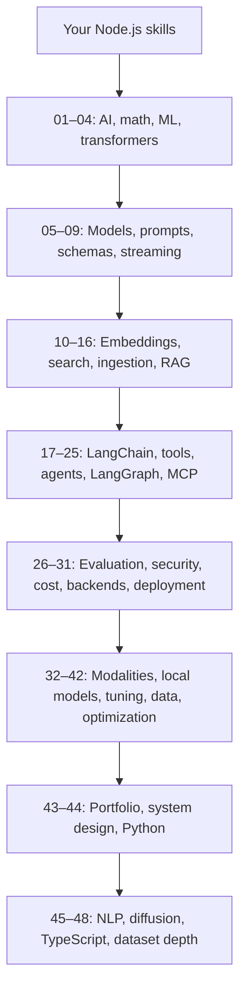
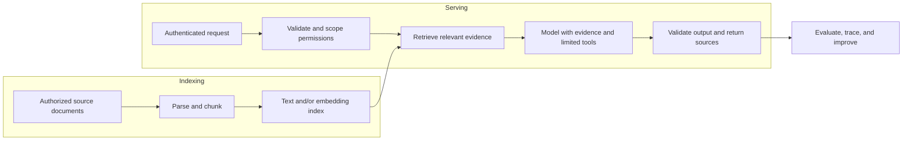

# Node.js → AI Engineer

### A practical roadmap for developers who already know how to build software.

Learn AI engineering in plain language, one topic at a time. Start with small JavaScript examples, understand the ideas behind the frameworks, then build complete applications with retrieval, tools, evaluation, and sensible operational boundaries.

**48 topic guides · 48 runnable JavaScript examples · 3 capstone projects · diagrams · a 20-week study plan**

[Start learning](START_HERE.md) · [Topic index](#topic-index) · [Study plan](STUDY_PLAN.md) · [Projects](projects/README.md) · [Glossary](GLOSSARY.md) · [Official resources](RESOURCES.md) · [Contribute](CONTRIBUTING.md)

## Who this is for

You can write JavaScript, use async/await, call an API, and work with npm. You may have built Express, NestJS, or Fastify services. You do **not** need previous AI experience, advanced math, Python, a GPU, or an API key to begin.

This roadmap focuses on application AI engineering: building useful and measurable products around models and data. It also introduces ML, training, inference, and research so you can choose a deeper specialization. AI is a large field; no single repository exhausts every research topic or guarantees a job. The goal is a strong, practical map and a foundation you can extend.

## Your first ten minutes

Install Node.js **22.14 or newer**. Use Node 22 to match the repository’s baseline.

```bash
# After cloning YOUR published repository, run inside its root:
npm ci
npm run learn -- --list
npm run learn -- 01
npm run learn -- 10
npm run demo -- "How many days of annual leave?"
```

These commands need no API credentials. The first install downloads npm dependencies. Chapter 10 uses lexical count vectors by default so you can inspect the mechanics; its `--live` option uses real semantic embeddings.

For paid model examples, copy [.env.example](.env.example) to `.env`, set `OPENAI_API_KEY`, and set `OPENAI_MODEL` to a model available to your account:

```bash
cp .env.example .env
# Edit .env in your editor. Keep it out of Git.
npm run learn -- 06
npm run demo -- --live "What is the remote work policy?"
```

[Full setup, Windows commands, execution modes, and troubleshooting →](START_HERE.md)

## The path



Read the root overview, then follow topic READMEs. Each chapter has a simple explanation, prerequisites, a runnable example, honest limits, an exercise, a completion checkpoint, source links, and previous/next navigation. Progress by demonstrating the checkpoint, not by merely reading the heading.

A suggested pace is **20 weeks at 7–10 hours per week**, with more time for unfamiliar math or capstone extensions. If you want an early result, read 01, 05–08, and 10–14, then try the documentation assistant. Return to foundations and production chapters before treating it as a complete system.

## What the core ideas mean

| Term | Easy explanation | Node.js connection |
| --- | --- | --- |
| LLM | A model that generates language from patterns learned during training | A network dependency with uncertain output |
| Prompt | The task, constraints, and context sent to the model | A function specification plus inputs |
| Embedding | A learned vector representation of an input | Numeric data you store and compare |
| Vector search | Find nearby representations | An index optimized for similarity |
| RAG | Retrieve evidence, then ask a model to answer from it | Search service + prompt construction + generation |
| LangChain | Reusable interfaces and integrations for model applications | Composition of prompts, models, parsers, tools |
| LangGraph | Explicit stateful workflow orchestration | A graph-shaped state machine |
| Agent | A model-driven loop that can choose tools and react to results | A bounded orchestrator around handlers |
| MCP | A shared protocol for exposing capabilities to AI applications | A connector interface, not a model |
| Evaluation | Measure whether the system behaves well on representative cases | Tests plus task-quality measurements |
| Fine-tuning | Train model parameters on examples to shape behavior | A versioned training pipeline, not a prompt update |

## Topic index

Every link opens a topic-specific README. Examples run from the repository root with `npm run learn -- <number>`.

- `offline`: no key or service; some chapters use installed npm libraries.
- `api`: real provider requests; requires credentials and may cost money.
- `local`: requires a separately installed local model service and weights.
- `service`: starts a local server that waits for a client.

| # | Guide | What you will learn | Example | Mode |
| --- | --- | --- | --- | --- |
| 01 | [What an AI engineer actually builds](topics/01-ai-engineering/README.md) | Map your backend skills to AI work | [Code](examples/01-ai-engineering.mjs) | `offline` |
| 02 | [The useful math: vectors, probability, and gradients](topics/02-math-for-ai/README.md) | Vectors, probability, gradients | [Code](examples/02-math-for-ai.mjs) | `offline` |
| 03 | [Machine learning fundamentals](topics/03-machine-learning/README.md) | Training, metrics, leakage, baselines | [Code](examples/03-machine-learning.mjs) | `offline` |
| 04 | [Neural networks and transformers](topics/04-neural-networks-transformers/README.md) | Attention and model architecture | [Code](examples/04-neural-networks-transformers.mjs) | `offline` |
| 05 | [Tokens, context windows, and model settings](topics/05-tokens-and-context/README.md) | Tokenizer and context budgets | [Code](examples/05-tokens-and-context.mjs) | `offline` |
| 06 | [Your first real model API call](topics/06-model-apis/README.md) | One bounded real model request | [Code](examples/06-model-apis.mjs) | `api` |
| 07 | [Prompt engineering without magic](topics/07-prompt-engineering/README.md) | Clear tasks and representative examples | [Code](examples/07-prompt-engineering.mjs) | `offline` |
| 08 | [Structured outputs and schema validation](topics/08-structured-outputs/README.md) | Schemas, refusals, business validation | [Code](examples/08-structured-outputs.mjs) | `api` |
| 09 | [Streaming and a responsive user experience](topics/09-streaming/README.md) | Events, cancellation, partial output | [Code](examples/09-streaming.mjs) | `api` |
| 10 | [Embeddings and semantic similarity](topics/10-embeddings/README.md) | Semantic representations and cosine | [Code](examples/10-embeddings.mjs) | `offline` |
| 11 | [Vector databases, pgvector, and indexes](topics/11-vector-databases/README.md) | Exact/ANN search, pgvector, filtering | [Code](examples/11-vector-databases.mjs) | `offline` |
| 12 | [Document loading, parsing, and cleaning](topics/12-document-ingestion/README.md) | Parsing, OCR, provenance, updates | [Code](examples/12-document-ingestion.mjs) | `offline` |
| 13 | [Chunking: splitting text without losing meaning](topics/13-chunking/README.md) | Boundaries, overlap, token limits | [Code](examples/13-chunking.mjs) | `offline` |
| 14 | [RAG from first principles](topics/14-rag/README.md) | Evidence retrieval plus generation | [Code](examples/14-rag.mjs) | `offline` |
| 15 | [BM25, hybrid search, and reranking](topics/15-hybrid-search-reranking/README.md) | BM25, dense retrieval, RRF, rerankers | [Code](examples/15-hybrid-search-reranking.mjs) | `offline` |
| 16 | [Advanced RAG patterns and when to use them](topics/16-advanced-rag/README.md) | Parent-child, rewriting, multi-hop | [Code](examples/16-advanced-rag.mjs) | `offline` |
| 17 | [LangChain for JavaScript developers](topics/17-langchain/README.md) | Templates, models, parsers, composition | [Code](examples/17-langchain.mjs) | `api` |
| 18 | [Tool calling: let models request code safely](topics/18-tool-calling/README.md) | Schemas, dispatch, authorization | [Code](examples/18-tool-calling.mjs) | `api` |
| 19 | [Agents and the bounded tool loop](topics/19-agents/README.md) | Tool loops, budgets, stopping | [Code](examples/19-agents.mjs) | `api` |
| 20 | [LangGraph: state, nodes, edges, and routing](topics/20-langgraph/README.md) | State, nodes, conditional edges | [Code](examples/20-langgraph.mjs) | `offline` |
| 21 | [Conversation memory and long-term knowledge](topics/21-memory/README.md) | History, sessions, long-term facts | [Code](examples/21-memory.mjs) | `offline` |
| 22 | [Human approval, interruption, and safe resumption](topics/22-human-in-the-loop/README.md) | Pause, review, resume, replay safety | [Code](examples/22-human-in-the-loop.mjs) | `offline` |
| 23 | [MCP: a common interface for tools and resources](topics/23-model-context-protocol/README.md) | Hosts, clients, servers, transports | [Code](examples/23-model-context-protocol.mjs) | `service` |
| 24 | [Multi-agent systems and orchestration tradeoffs](topics/24-multi-agent-systems/README.md) | Roles, handoffs, coordination costs | [Code](examples/24-multi-agent-systems.mjs) | `offline` |
| 25 | [Reasoning models and context engineering](topics/25-reasoning-context-engineering/README.md) | Select context and verify artifacts | [Code](examples/25-reasoning-context-engineering.mjs) | `offline` |
| 26 | [Evaluating retrieval, answers, and agents](topics/26-evaluation/README.md) | Recall, MRR, answer and agent quality | [Code](examples/26-evaluation.mjs) | `offline` |
| 27 | [Tracing, metrics, and debugging AI requests](topics/27-observability/README.md) | Traces, metrics, privacy-aware logs | [Code](examples/27-observability.mjs) | `offline` |
| 28 | [Prompt injection, permissions, and secure tool execution](topics/28-security/README.md) | Injection, tool policy, tenant isolation | [Code](examples/28-security.mjs) | `offline` |
| 29 | [Cost, latency, caching, and reliability budgets](topics/29-cost-latency-caching/README.md) | Budgets, caching, retries, fallbacks | [Code](examples/29-cost-latency-caching.mjs) | `offline` |
| 30 | [Building AI HTTP APIs in Node.js](topics/30-nodejs-backends/README.md) | Validation, deadlines, API contracts | [Code](examples/30-nodejs-backends.mjs) | `offline` |
| 31 | [Deployment, versioning, and LLMOps](topics/31-deployment-llmops/README.md) | Versioning, canaries, rollback, indexes | [Code](examples/31-deployment-llmops.mjs) | `offline` |
| 32 | [Images, OCR, document understanding, and multimodal models](topics/32-multimodal-ai/README.md) | Vision, OCR, layout, extraction | [Code](examples/32-multimodal-ai.mjs) | `api` |
| 33 | [Speech, audio, and realtime assistants](topics/33-voice-and-realtime/README.md) | Speech pipelines, interruption, media | [Code](examples/33-voice-and-realtime.mjs) | `offline` |
| 34 | [Local models and open-weight deployment](topics/34-local-open-models/README.md) | Ollama, weights, hardware, licenses | [Code](examples/34-local-open-models.mjs) | `local` |
| 35 | [Fine-tuning, LoRA, and preference optimization](topics/35-fine-tuning/README.md) | SFT, LoRA, QLoRA, preferences | [Code](examples/35-fine-tuning.mjs) | `offline` |
| 36 | [Queues, incremental indexing, and data lifecycle](topics/36-data-pipelines/README.md) | Queues, idempotency, deletion, freshness | [Code](examples/36-data-pipelines.mjs) | `offline` |
| 37 | [Semantic search, clustering, and recommendations](topics/37-search-recommendations/README.md) | Candidates, profiles, diversity, cold start | [Code](examples/37-search-recommendations.mjs) | `offline` |
| 38 | [Testing deterministic code and probabilistic behavior](topics/38-testing-ai-systems/README.md) | Unit tests, fakes, live evaluation | [Code](examples/38-testing-ai-systems.mjs) | `offline` |
| 39 | [Responsible AI, privacy, and accessible products](topics/39-responsible-ai/README.md) | Privacy, bias, accessibility, governance | [Code](examples/39-responsible-ai.mjs) | `offline` |
| 40 | [A/B tests, feedback, and continuous improvement](topics/40-experimentation/README.md) | Randomization, guardrails, feedback | [Code](examples/40-experimentation.mjs) | `offline` |
| 41 | [GraphRAG, knowledge graphs, and text-to-SQL](topics/41-graph-rag-and-text-to-sql/README.md) | Relationships and constrained SQL | [Code](examples/41-graph-rag-and-text-to-sql.mjs) | `offline` |
| 42 | [Quantization, distillation, batching, and serving](topics/42-model-optimization/README.md) | Quantization, KV cache, batching | [Code](examples/42-model-optimization.mjs) | `offline` |
| 43 | [AI system design, capstones, and interview preparation](topics/43-system-design-portfolio/README.md) | Architecture, capstones, interviews | [Code](examples/43-system-design-portfolio.mjs) | `offline` |
| 44 | [The Python bridge and reading AI research](topics/44-python-and-research/README.md) | Python tools and reading papers | [Code](examples/44-python-and-research.mjs) | `offline` |
| 45 | [NLP: text processing before and beyond LLMs](topics/45-nlp-fundamentals/README.md) | N-grams, TF-IDF, language processing | [Code](examples/45-nlp-fundamentals.mjs) | `offline` |
| 46 | [Image generation and diffusion fundamentals](topics/46-image-generation-diffusion/README.md) | Denoising, conditioning, media workflows | [Code](examples/46-image-generation-diffusion.mjs) | `offline` |
| 47 | [TypeScript contracts and the JavaScript AI ecosystem](topics/47-typescript-and-js-ecosystem/README.md) | Types, runtime schemas, library choices | [Code](examples/47-typescript-and-js-ecosystem.mjs) | `offline` |
| 48 | [Datasets, labeling, and reproducible experiments](topics/48-datasets-and-labeling/README.md) | Labels, splits, dataset versions | [Code](examples/48-datasets-and-labeling.mjs) | `offline` |

## Learn by building

| Milestone | Build | Show that it works |
| --- | --- | --- |
| After 09 | Ticket classifier | Validated schema, refusal/error handling, representative examples |
| After 16 | [Documentation assistant](projects/docs-assistant/README.md) | Evidence IDs, abstention cases, retrieval evaluation |
| After 25 | [Support review workflow](projects/support-workflow/README.md) | Exact-payload approval, denied action, replay prevention |
| After 31 | [HTTP retrieval service](projects/rag-api/README.md) | Input bounds, tenant isolation, deterministic integration tests |
| After 48 | Your own portfolio extension | Measured quality, architecture, failure analysis, clear limitations |

The capstones are small learning implementations. The local API returns retrieved excerpts; live generation is in the documentation assistant. The workflow simulates approval and never moves money. Each project README identifies its implemented behavior and extension work.

## How the pieces fit together



Security and evaluation belong throughout the path. A model instruction is not access control. A valid JSON object is not necessarily correct. A citation marker is not proof of support. Build deterministic boundaries and measure model behavior separately.

## Repository layout

```text
README.md             Overview and complete topic index
START_HERE.md         Setup, commands, modes, troubleshooting
STUDY_PLAN.md         Weekly goals and readiness checkpoints
GLOSSARY.md           Plain-language reference
RESOURCES.md          Official sources and verification notes
PROGRESS.md           Copyable learning checklist
topics/               48 chapter READMEs + index.json
examples/             48 chapter scripts, shared helpers, fictional data
projects/             Three runnable capstones
tests/                Deterministic boundary and integration tests
scripts/              Chapter runner and repository checks
.github/              CI and contribution templates
```

## Verify your checkout

```bash
npm run check                 # Syntax, local links, anchors, index coverage
npm test                      # Offline tests; no paid model calls
npm run learn -- --offline    # Run all chapters marked offline
```

CI runs these checks on Node 22 and 24. Live provider quality, local model inference, a real PostgreSQL database, and external browser/voice integrations require separate setup and evaluation. See [verification notes](VERIFICATION.md).

## Contribute and publish

Corrections, clearer explanations, new exercises, and useful failure cases are welcome. Read [CONTRIBUTING.md](CONTRIBUTING.md) and [CODE_OF_CONDUCT.md](CODE_OF_CONDUCT.md). Use fictional or properly licensed data. The repository uses the [MIT license](LICENSE); linked tools, models, datasets, and documentation keep their own terms.

To publish, follow [PUBLISHING.md](PUBLISHING.md). No GitHub account, remote URL, or deployment is assumed by this repository.
