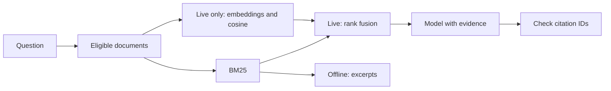

# Capstone 1: documentation assistant

[Project index](../README.md) · [RAG chapter](../../topics/14-rag/README.md)

Ask questions about a tiny fictional handbook. The default path needs no credentials and returns source excerpts. The live path uses real embeddings and generation.

## Run from the repository root

```bash
npm run demo
npm run demo -- "What receipts are required for expenses?"
# After configuring .env; this makes paid API calls:
npm run demo -- --live "How many days of annual leave do employees receive?"
```

Offline output includes `mode: "retrieved-excerpts"`, the question, and source IDs/text. It is intentionally not called a generated answer. A query with no lexical hits returns an abstention.

Live mode filters documents to the fixed demo tenant, embeds the query and eligible documents, performs cosine and BM25 ranking, fuses ranks, sends the top two sources to a model, and validates cited IDs. It may return `I do not know.` when evidence is insufficient. Each invocation re-embeds the tiny corpus; a real application should build and version an index separately.



## Read the code

[index.mjs](index.mjs) owns the request flow. Shared [retrieval helpers](../../examples/lib/retrieval.mjs) handle BM25, fusion, and prompts. [provider.mjs](../../examples/lib/provider.mjs) contains the provider boundary. The fixtures include another tenant to exercise isolation.

Citation validation proves only that IDs exist in the retrieved set. It does not prove the answer’s claims are supported. Dense retrieval always has nearest neighbors, even for unrelated questions; evaluate abstention rather than treating closeness as certainty. A lexical miss also does not establish that a question is truly unsupported.

## Extend it

1. Load versioned Markdown documents and preserve source headings.
2. Build a persistent vector index and avoid re-embedding unchanged content.
3. Add a labeled question set with supported and unsupported queries.
4. Measure BM25, dense, hybrid, and reranked variants separately.
5. Add real authentication before supporting user-selectable corpora.

Run `npm run learn -- 26` for the small retrieval evaluation and `npm test` for deterministic boundary checks. The repository does not include a measured live-model quality score.
