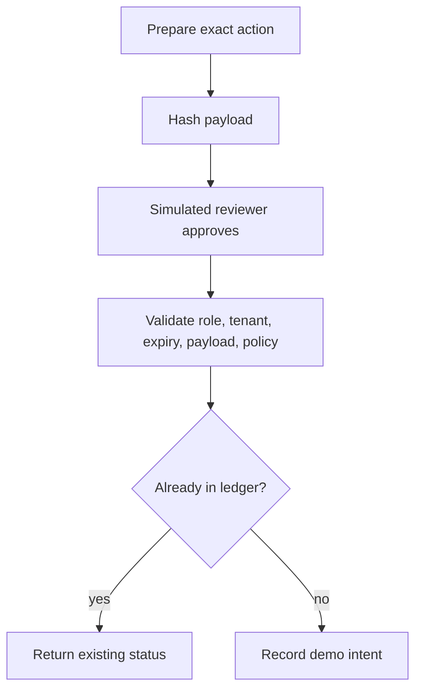

# Capstone 2: support approval workflow

[Project index](../README.md) · [Human review chapter](../../topics/22-human-in-the-loop/README.md)

Prepare a fictional refund intent, then demonstrate approval bound to its exact payload. This project records no real payment and contacts no service.

```bash
npm run workflow
npm run workflow -- --approve-demo
```

The first command prints a pending action. The second creates a simulated reviewer context, binds approval to a hash of the operation, tenant, order, amount, and currency, records the demo intent, then demonstrates a replay returning `already-recorded`.



[workflow.mjs](workflow.mjs) separates preparation, approval, and execution checks. Tests cover changed amounts, expired approval, wrong tenant, and replay. The [LangGraph interrupt example](../../examples/22-human-in-the-loop.mjs) separately teaches framework pause/resume mechanics.

The reviewer object, approval object, and ledger are trusted in-process fixtures. This is not an authentication system or a cryptographically signed external approval token. The Set is ephemeral and the check/write is not a durable transaction. Never accept an approval object from an arbitrary client as proof.

To extend it, add authenticated reviewer sessions, a durable review record, immutable action snapshots, expiry, database transactions or an outbox, and an external operation idempotency key. Test crashes before and after the external action. Build a review screen that shows the exact action and evidence before adding any real write tool.
