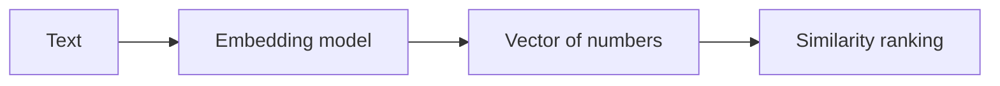

# 10. Embeddings and semantic similarity

[Roadmap index](../../README.md#topic-index) · [Setup](../../START_HERE.md) · [Glossary](../../GLOSSARY.md)

**Stage:** Retrieval and RAG  
**Run mode:** Offline: no API key or external service required.  
**Before this chapter:** [02](../02-math-for-ai/README.md), [05](../05-tokens-and-context/README.md)

> Embeddings let software compare meaning using numbers, which unlocks semantic search, clustering, and recommendations.

## A location in meaning space

An embedding model turns an input into a vector. Think of it as assigning coordinates based on patterns learned during training. Related inputs often land near each other. A query about “holiday allowance” may match “annual leave,” even when the exact words differ.

These coordinates are learned features, not a readable list of human concepts. Dimension 17 does not necessarily mean “happiness.” Embeddings can represent text, images, audio, or other inputs depending on the model. Different models create different spaces.

## Compare compatible vectors

Use the same model, dimensions, and preprocessing contract for documents and queries. Equal vector lengths do not prove compatibility. When changing embedding models, rebuild a versioned index and evaluate before moving traffic. Do not mix old and new vectors in the same search space.

Cosine similarity, dot product, and Euclidean distance rank closeness in different ways. Normalization affects their relationship. A similarity threshold must be calibrated on your data; `0.8` is not a universal definition of a relevant answer.

## Why the offline example misses synonyms

A count vector stores counts from a fixed vocabulary. It is a simple lexical representation, not a learned semantic model. It is useful for understanding vectors without an API key. The optional live mode embeds two phrases with an actual model so you can compare the behavior.

Embeddings can retain sensitive information about source inputs. Treat stored vectors and associated text as protected data. Index access is still subject to the same permission rules as the original documents.

## Visual walkthrough



## Read and run the example

[Full JavaScript example](../../examples/10-embeddings.mjs)

```bash
# Run from the repository root, after following START_HERE.md.
npm run learn -- 10
```

```javascript
import { cosine, countVector } from './lib/math.mjs';
const vocabulary = ['leave', 'annual', 'remote', 'work'];
const query = countVector('annual leave', vocabulary);
for (const text of ['annual leave policy', 'remote work policy', 'holiday allowance']) {
  console.log(text, cosine(query, countVector(text, vocabulary)));
}
console.log('Notice the synonym miss: these are lexical counts, not learned semantic embeddings.');
// Run with --live for real embeddings; requires a provider key.
if (process.argv.includes('--live')) {
  const { embed } = await import('./lib/provider.mjs');
  const [a, b] = await embed(['annual leave', 'holiday allowance']);
  console.log('Semantic model cosine:', cosine(a, b));
}
```

The default mode compares dictionary count vectors and explicitly shows a synonym miss. `npm run learn -- 10 --live` calls a real embedding API and prints a cosine score for two related phrases.

**Expected behavior:** Inspect the labeled values in stdout and compare them with the walkthrough above. Output is deterministic except for timings and generated IDs where present.

## Try it yourself

Create ten paraphrase pairs and ten unrelated pairs. Compare their score distributions before choosing any threshold.

## You are ready to move on when…

Explain why changing embedding models requires rebuilding and reevaluating the index.

## Learn from the source

[Official OpenAI embeddings reference](https://developers.openai.com/api/reference/typescript/resources/embeddings/methods/create). API details can change; compare the installed version with official documentation. See [sources and verification notes](../../RESOURCES.md).

---

[← Streaming and a responsive user experience](../09-streaming/README.md) · [Vector databases, pgvector, and indexes →](../11-vector-databases/README.md)
