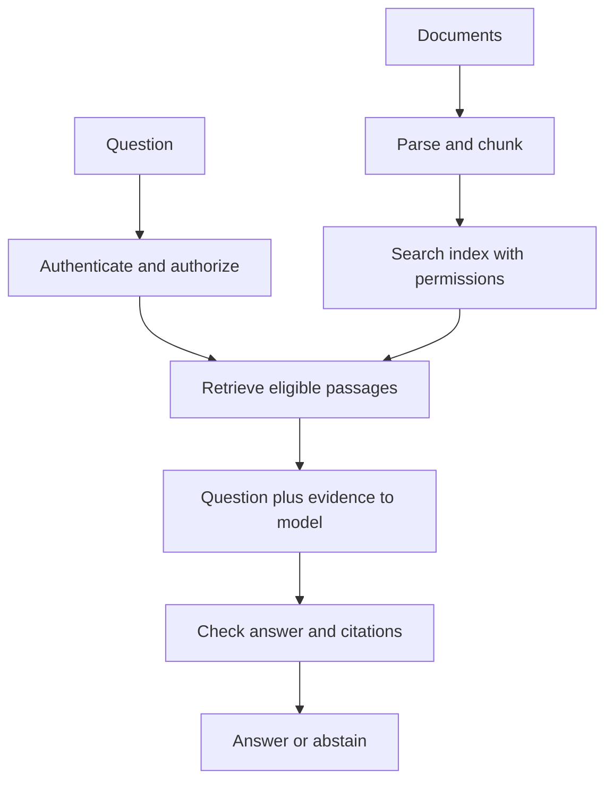

# 14. RAG from first principles

[Roadmap index](../../README.md#topic-index) · [Setup](../../START_HERE.md) · [Glossary](../../GLOSSARY.md)

**Stage:** Retrieval and RAG  
**Run mode:** Offline: no API key or external service required.  
**Before this chapter:** [06](../06-model-apis/README.md), [10](../10-embeddings/README.md), [11](../11-vector-databases/README.md), [12](../12-document-ingestion/README.md), [13](../13-chunking/README.md)

> Retrieval-augmented generation helps a model answer from your documents without retraining it every time a policy changes.

## An open-book answer

Think of the model as a student and your documents as a textbook. Without retrieval, the student answers from learned patterns. With **RAG**, your application finds useful passages and puts them beside the question. The model then writes an answer using that evidence.

RAG has two paths. The indexing path loads documents, cleans them, splits them, represents them for search, and stores them with metadata. The query path authenticates a user, searches eligible evidence, prepares a prompt, generates an answer, and returns sources.

## Retrieval and generation can fail independently

If retrieval finds the wrong paragraph, the model may confidently summarize the wrong evidence. If retrieval succeeds, generation can still misread it or add unsupported claims. Evaluate retrieval separately from final answers so you know which part to improve.

The simplest useful baseline may be lexical search such as BM25. Dense embeddings help with paraphrases; hybrid search combines signals. You do not need a framework or a vector database to understand the architecture.

## Evidence must remain evidence

Tell the generator to answer from supplied text, cite source IDs, and say when evidence is insufficient. These instructions guide behavior; they do not create a security boundary or guarantee grounding. Check citations against the actual retrieved IDs and evaluate whether claims are supported. A citation can be present and still be wrong.

Enforce access before evidence enters the model. Avoid cross-tenant cache keys. Treat retrieved instructions as untrusted content. When evidence is missing, returning “I do not know” is often the correct product behavior.

## Visual walkthrough



## Read and run the example

[Full JavaScript example](../../examples/14-rag.mjs)

```bash
# Run from the repository root, after following START_HERE.md.
npm run learn -- 14
```

```javascript
import { handbook } from './lib/data.mjs';
import { retrieve, groundedPrompt } from './lib/retrieval.mjs';
const question = 'How many days of annual leave do employees receive?';
const hits = retrieve(question, handbook, { tenantId: 'demo', k: 2 });
console.log('Retrieved evidence:', hits);
console.log('Prompt for generation:', groundedPrompt(question, hits));
console.log('This offline example prepares evidence; it does not generate an answer.');
// The complete CLI in projects/docs-assistant supports real generation with --live.
```

The topic example retrieves handbook passages with BM25 and prints the generation prompt. The [docs assistant project](../../projects/docs-assistant/README.md) completes the flow with optional real embeddings and model generation.

**Expected behavior:** Inspect the labeled values in stdout and compare them with the walkthrough above. Output is deterministic except for timings and generated IDs where present.

## Try it yourself

Ask a supported leave question and an unsupported salary question. Describe the expected abstention behavior and inspect the retrieved passages.

## You are ready to move on when…

Draw the indexing and query paths, and identify one failure mode at each stage.

## Learn from the source

[Original RAG paper](https://arxiv.org/abs/2005.11401). API details can change; compare the installed version with official documentation. See [sources and verification notes](../../RESOURCES.md).

---

[← Chunking: splitting text without losing meaning](../13-chunking/README.md) · [BM25, hybrid search, and reranking →](../15-hybrid-search-reranking/README.md)
