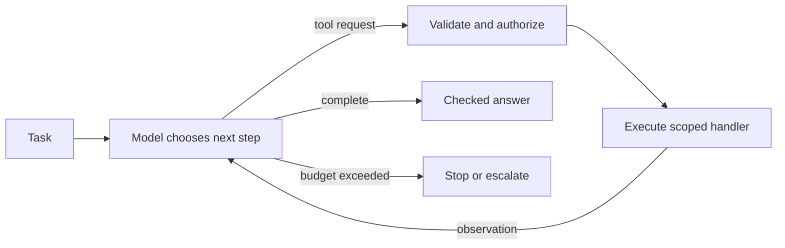

# 19. Agents and the bounded tool loop

[Roadmap index](../../README.md#topic-index) · [Setup](../../START_HERE.md) · [Glossary](../../GLOSSARY.md)

**Stage:** Agents and workflows  
**Run mode:** API: credentials and a compatible model are required; calls may cost money.  
**Before this chapter:** [17](../17-langchain/README.md), [18](../18-tool-calling/README.md)

> Agents are useful when the next action depends on information discovered along the way.

## What makes it an agent?

A fixed workflow follows steps selected by your code. An agent lets a model choose some next steps, usually by selecting tools and reacting to their results. A common loop is: receive task → choose action → run tool → observe result → answer or choose another action.

The ReAct idea combines reasoning about a task with actions and observations. In an application, focus on the observable actions and evidence rather than treating generated reasoning as a reliable audit trail. A model can choose the wrong tool or keep searching without making progress.

## Put a fence around autonomy

Give the agent a small tool set, a scoped task, step limits, timeouts, and a cost budget. Validate each action at the execution boundary. Decide what happens when the step limit is reached: return a useful failure state or ask for human help instead of silently looping.

Use ordinary code for stable rules. If every ticket must go through the same three checks, a deterministic workflow may be easier to operate. Use an agent when choosing among tools is a meaningful part of solving the task.

## Evaluate actions, not just prose

Did it choose a necessary tool? Were the arguments valid? Did it stop after obtaining evidence? Did it avoid a write action without approval? Did the final answer agree with the tool result? Track unnecessary calls, repeated calls, failures, and total latency.

A strong model cannot compensate for an overpowered tool. Keep permissions narrow and avoid exposing credentials or full databases in tool descriptions or outputs.

## Visual walkthrough



## Read and run the example

[Full JavaScript example](../../examples/19-agents.mjs)

```bash
# Run from the repository root, after following START_HERE.md.
npm run learn -- 19
```

```javascript
import { createAgent, tool } from 'langchain';
import { ChatOpenAI } from '@langchain/openai';
import { z } from 'zod';
import { getModel } from './lib/provider.mjs';
const lookup = tool(async ({ orderId }) => JSON.stringify({ orderId, status: 'shipped' }), {
  name: 'lookup_order', description: 'Read status of the demo order.',
  schema: z.object({ orderId: z.enum(['demo-order']) }),
});
const agent = createAgent({
  model: new ChatOpenAI({ model: getModel(), timeout: 30000, maxRetries: 1 }),
  tools: [lookup], systemPrompt: 'Help with order status. Use lookup_order for facts. Never invent delivery dates.',
});
const result = await agent.invoke({ messages: [{ role: 'user', content: 'Where is demo-order?' }] }, { recursionLimit: 6 });
console.log(result.messages.at(-1).content);
```

The LangChain agent has one read-only order tool and a recursion limit. The tool returns a synthetic shipment status; the model chooses whether to call it.

**Expected behavior:** A model-generated order response after tool use when needed; wording varies.

## Try it yourself

Ask an unrelated question and inspect whether the agent calls the order tool unnecessarily. Add cases to an action-selection evaluation set.

## You are ready to move on when…

Explain when a fixed workflow is a better choice than a model-driven loop.

## Learn from the source

[LangChain JavaScript agents](https://docs.langchain.com/oss/javascript/langchain/agents). API details can change; compare the installed version with official documentation. See [sources and verification notes](../../RESOURCES.md).

---

[← Tool calling: let models request code safely](../18-tool-calling/README.md) · [LangGraph: state, nodes, edges, and routing →](../20-langgraph/README.md)
